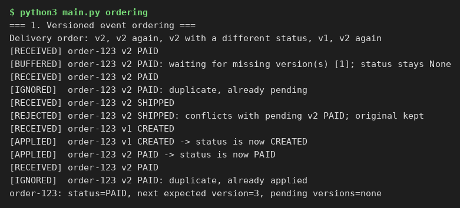
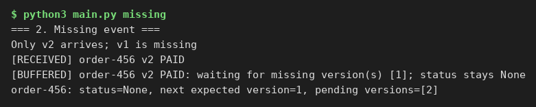
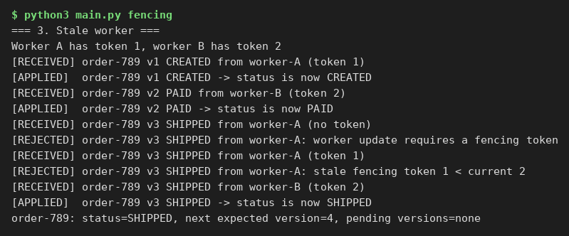

# CMPE-273 Module 7: Versioned Order Processing

A small order-processing simulation in Python. An order moves through
versioned states. Events may arrive late, out of order, or more than once. Ordering is
decided by the version number, not by arrival time or timestamp.

order_processor.py holds the Order class and the OrderEvent dataclass.
Every update is an event carrying order_id, version, and status, plus
the worker name and its fencing token for worker updates. An event is
applied only when its version is the next expected one, a later version
is buffered as pending, duplicates are ignored, a conflicting repeat of
a pending version is rejected, and a worker update with a stale token
or no token is rejected. main.py runs the three demos below.

## Running the program

Requires Python 3, no extra packages.

```bash
python3 main.py            # run all three demos
python3 main.py ordering   # out-of-order + duplicate delivery
python3 main.py missing    # later version only, earlier version missing
python3 main.py fencing    # stale worker rejected by fencing token
```

## Example: correct event ordering

Delivery order: v2, v2 again, v2 with a different status, v1, v2 again.

```bash
$ python3 main.py ordering
```

```
=== 1. Versioned event ordering ===
Delivery order: v2, v2 again, v2 with a different status, v1, v2 again
[RECEIVED] order-123 v2 PAID
[BUFFERED] order-123 v2 PAID: waiting for missing version(s) [1]; status stays None
[RECEIVED] order-123 v2 PAID
[IGNORED]  order-123 v2 PAID: duplicate, already pending
[RECEIVED] order-123 v2 SHIPPED
[REJECTED] order-123 v2 SHIPPED: conflicts with pending v2 PAID; original kept
[RECEIVED] order-123 v1 CREATED
[APPLIED]  order-123 v1 CREATED -> status is now CREATED
[APPLIED]  order-123 v2 PAID -> status is now PAID
[RECEIVED] order-123 v2 PAID
[IGNORED]  order-123 v2 PAID: duplicate, already applied
order-123: status=PAID, next expected version=3, pending versions=none
```

v2 arrives first and is buffered instead of being applied. When v1
arrives, v1 is applied and the buffered v2 is then applied, so the
order ends as PAID in the correct order.



## Evidence: duplicate handling

The run above tests duplicates twice. The second v2, received while
v2 is still pending, is ignored (`duplicate, already pending`). A
repeat of v2 with a different status (SHIPPED instead of PAID) is
rejected (`conflicts with pending v2 PAID; original kept`), so it
cannot overwrite the buffered event. The final v2, received after v1
and v2 have already been applied, is ignored (`duplicate, already
applied`). The final status stays PAID and the next expected version
stays 3, so no duplicate has any effect.

## Evidence: missing-event case

Only v2 arrives; v1 is missing.

```bash
$ python3 main.py missing
```

```
=== 2. Missing event ===
Only v2 arrives; v1 is missing
[RECEIVED] order-456 v2 PAID
[BUFFERED] order-456 v2 PAID: waiting for missing version(s) [1]; status stays None
order-456: status=None, next expected version=1, pending versions=[2]
```

The order does not jump ahead to PAID. v2 is recorded as pending and
v1 is recorded as the missing version.



## Evidence: stale-worker rejection

Worker A has token 1, worker B has token 2.

```bash
$ python3 main.py fencing
```

```
=== 3. Stale worker ===
Worker A has token 1, worker B has token 2
[RECEIVED] order-789 v1 CREATED from worker-A (token 1)
[APPLIED]  order-789 v1 CREATED -> status is now CREATED
[RECEIVED] order-789 v2 PAID from worker-B (token 2)
[APPLIED]  order-789 v2 PAID -> status is now PAID
[RECEIVED] order-789 v3 SHIPPED from worker-A (no token)
[REJECTED] order-789 v3 SHIPPED from worker-A: worker update requires a fencing token
[RECEIVED] order-789 v3 SHIPPED from worker-A (token 1)
[REJECTED] order-789 v3 SHIPPED from worker-A: stale fencing token 1 < current 2
[RECEIVED] order-789 v3 SHIPPED from worker-B (token 2)
[APPLIED]  order-789 v3 SHIPPED -> status is now SHIPPED
order-789: status=SHIPPED, next expected version=4, pending versions=none
```

The worker with the newer token (B, token 2) can update the order.
Worker A is rejected twice: once for sending no fencing token at
all, and once for using its older token 1. The same update then
succeeds from worker B.



## Reflection: why are timestamps alone not enough?

Timestamps alone are not enough because clocks on different machines
can disagree, so two events can carry timestamps that do not match the
order they actually happened in. A timestamp also cannot say whether
an event is missing, since a later timestamp gives no way to know a
version in between never arrived. Delivery can also be delayed or
duplicated, so the same timestamp can arrive twice or a newer event
can arrive first. Version numbers fix this by giving each update an
explicit place in the sequence, so a receiver can wait for a missing
version, apply updates in order, and ignore duplicates.
